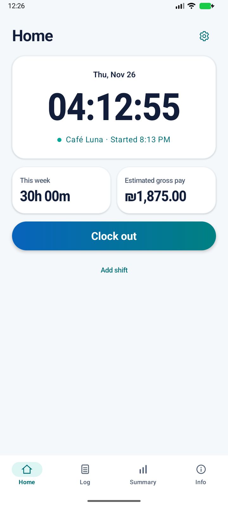
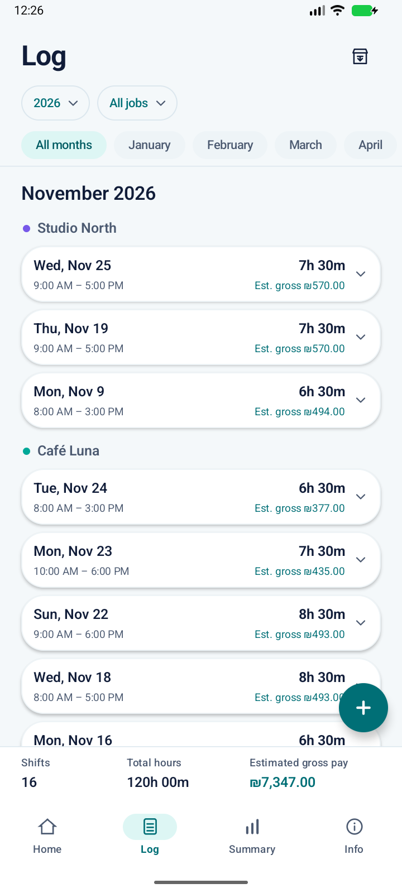
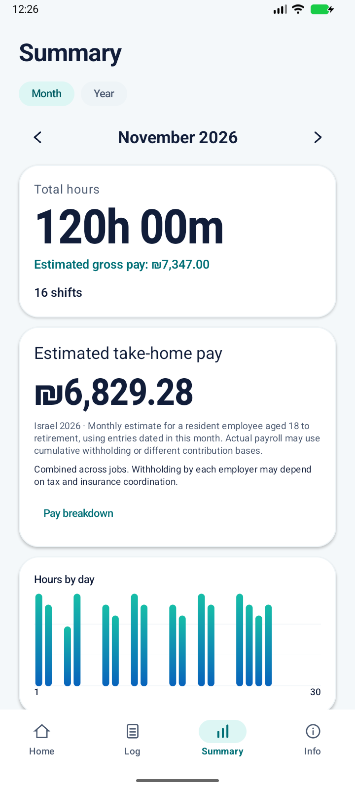

# HourThreads


this app was made with the help of ChatGPT Codex, if you dont like AI made apps, I totally understand :)


this is just a free app designed to help people estimate their monthly salaries and keep track of shifts.

--------------

HourThreads is a free, open-source Android app for tracking work hours and estimating pay across one or more jobs. Use it to clock in and out, record past shifts, and compare your own hours and pay estimates with your payslip.

## What you can do

- **Track time as you work.** Clock in and out, or add shifts manually. Enter a date range to apply the same hours across several days. The app handles overnight shifts, unpaid breaks, and paid vacation entries.
- **Keep a record for each job.** Set hourly rates and currencies per job. Record tips, bonuses, per-shift deductions, and travel or fuel reimbursements. When job pay changes, choose whether to apply it to past shifts.
- **Review your hours and estimated pay.** Filter the shift log by job and date, and see monthly and yearly summaries. Gross pay totals are shown separately by currency. The monthly Israeli payroll breakdown uses 2026 rules for ILS entries and lets you adjust tax credits and include or exclude income tax. Actual take-home pay can differ from the estimate.
- **Move your data between phones.** Export a JSON backup with jobs, shifts, and app preferences. Restore it during setup or from the Log tab. Schedule daily, weekly, or monthly backups to a folder you choose in Android Files, with optional reminders if saving fails.
- **Make it yours.** Choose a light, dark, or system theme and customize the accent colors. The interface is available in English, Hebrew, and Japanese.

## Screenshots

| Clock in and out | Shift log | Monthly summary |
| :---: | :---: | :---: |
|  |  |  |

## Privacy

Jobs, shifts, and settings are stored on your device. HourThreads works offline, requires no account, and contains no ads or tracking. If you choose a cloud-backed folder for a backup, your storage provider handles that copy. The full policy is available in the app under **Info → Privacy policy**.

## Build from source

HourThreads runs on Android 8.0 and later. Open the project in Android Studio with Android SDK Platform 37 and use JDK 17 or later for Gradle. [Android SDK setup](https://developer.android.com/about/versions/17/setup-sdk), [Android Gradle Plugin compatibility](https://developer.android.com/build/releases/agp-9-2-0-release-notes)

Run this command from the project root.

```sh
./gradlew :app:assembleDebug :app:testDebugUnitTest
```

On Windows, use `gradlew.bat`. The debug APK is written to `app/build/outputs/apk/debug/HourThreads.apk`.

If you report a bug, include your Android version, the app version, and steps to reproduce it. Use sample shift data if you attach a screenshot or backup.

## License

HourThreads is released under the [MIT License](LICENSE). The included Gradle Wrapper files are covered by the [Apache License 2.0](gradle/wrapper/LICENSE).

Made with love for everyone ❤️
